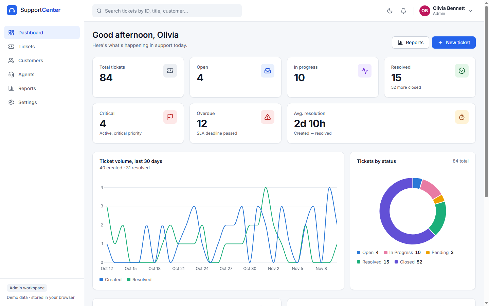
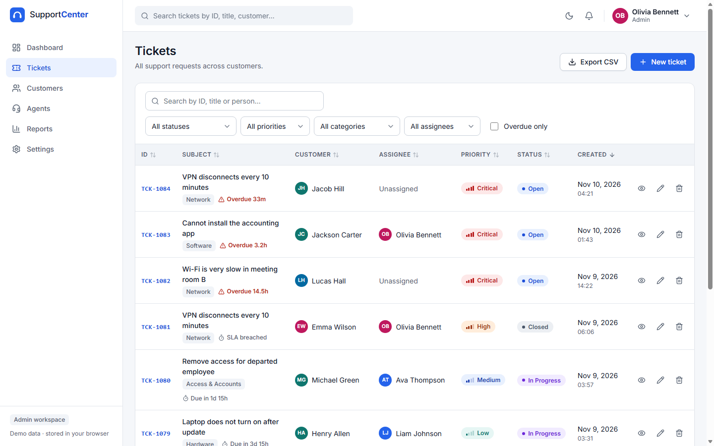
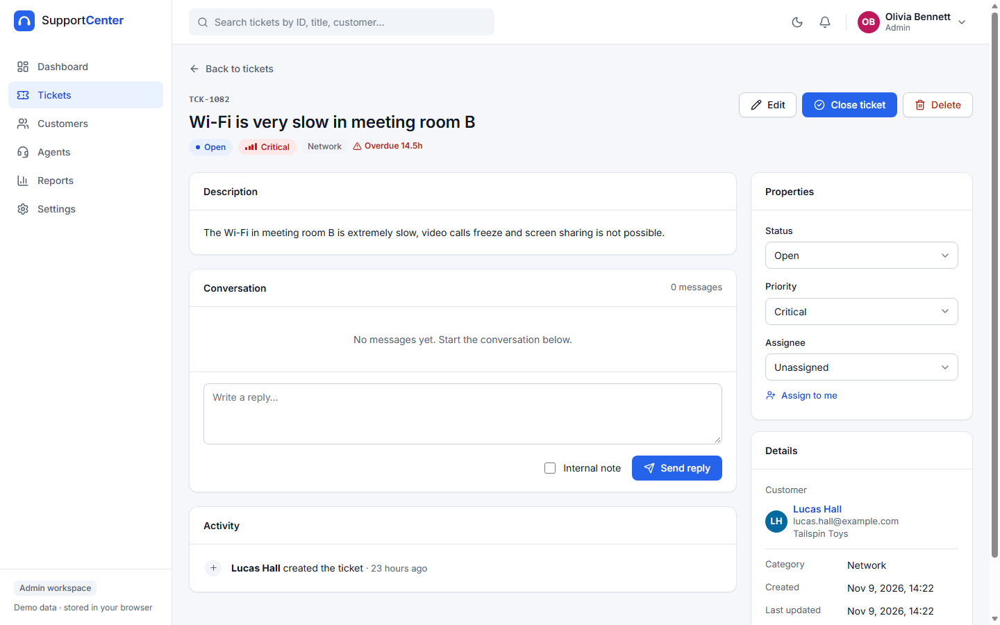
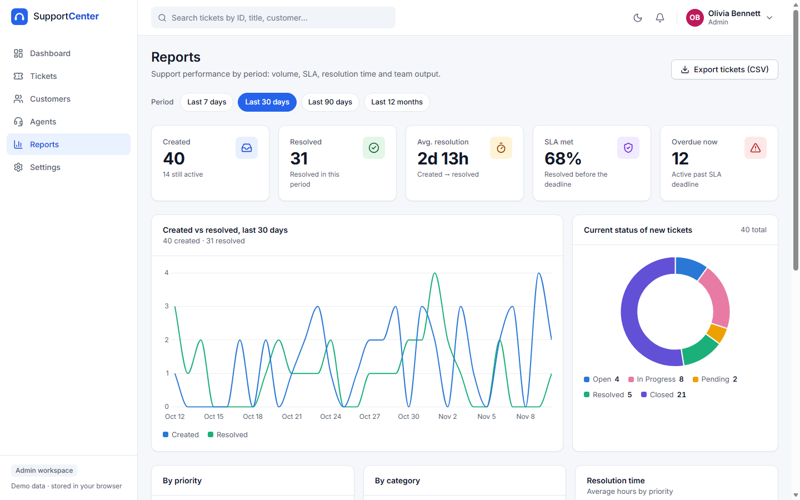
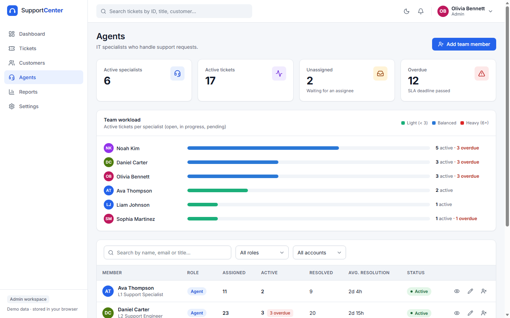
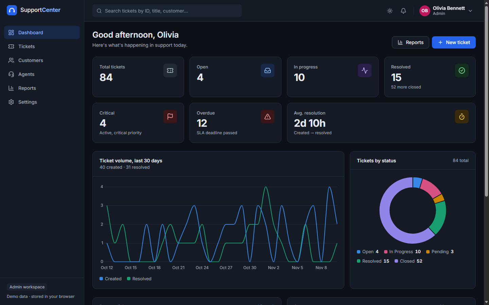
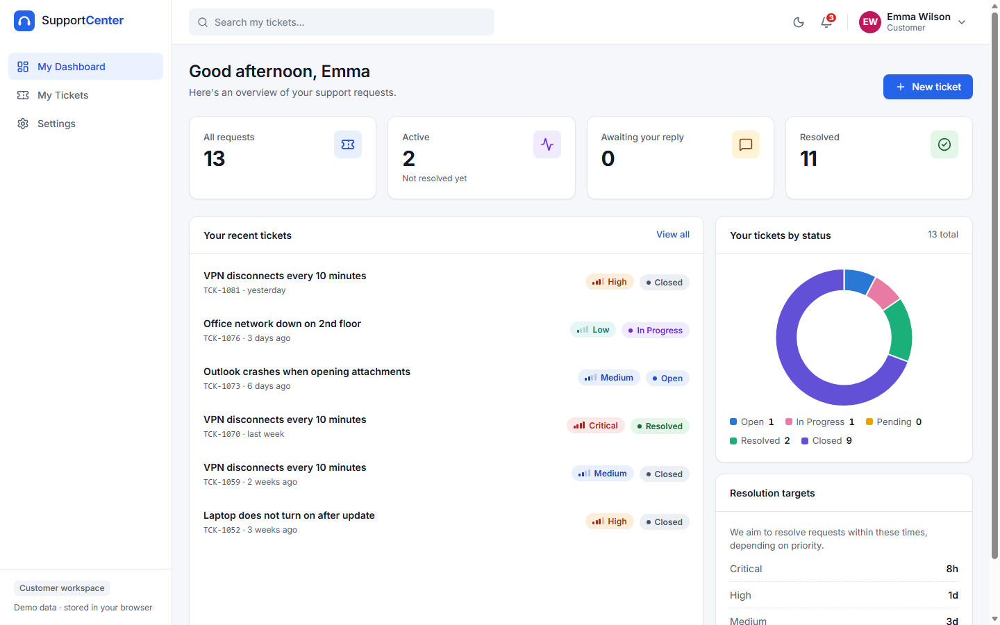
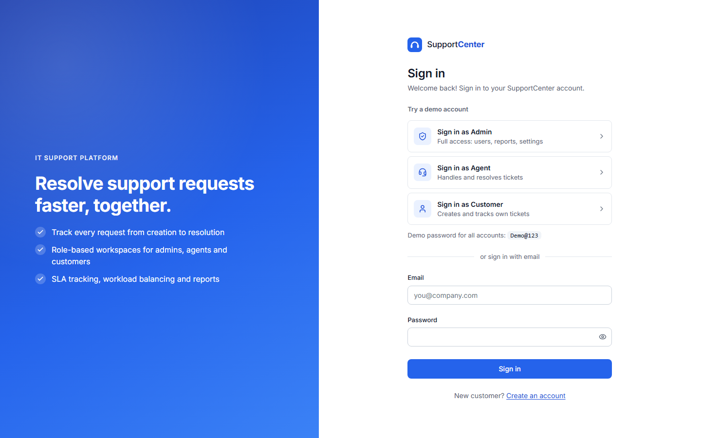
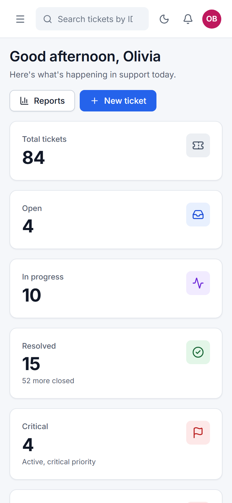
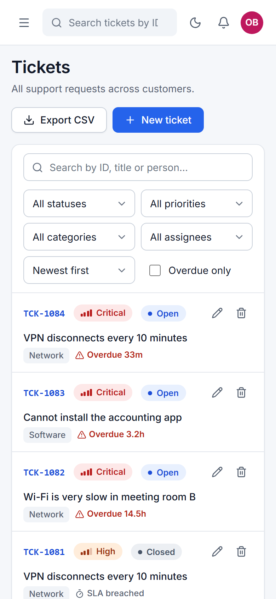

# SupportCenter

An IT helpdesk for tracking support tickets, built with **Angular 22**. It has three roles (Admin, Agent and Customer) and covers the whole ticket lifecycle: SLA tracking, conversations with internal notes, change history, workload balancing, analytics and CSV export.

The backend is a mock that stores everything in `localStorage` and adds simulated network latency. The data layer sits behind abstract repositories, so you can move it to Firebase by swapping a single provider.



## Contents

- [Features](#features)
- [Demo accounts](#demo-accounts)
- [Screenshots](#screenshots)
- [Tech stack](#tech-stack)
- [Getting started](#getting-started)
- [Architecture](#architecture)
- [Project structure](#project-structure)
- [Quality](#quality)
- [Deployment](#deployment)
- [Moving to Firebase](#moving-to-firebase)

## Features

### Roles

| Capability                           |  Admin  |   Agent   |      Customer      |
| ------------------------------------ | :-----: | :-------: | :----------------: |
| Dashboard                            |   ✅    |    ✅     |  ✅ (own tickets)  |
| View tickets                         |   All   |    All    |        Own         |
| Create tickets                       |   ✅    |    ✅     |         ✅         |
| Change status, priority and assignee |   ✅    |    ✅     | Close / reopen own |
| Internal notes                       |   ✅    |    ✅     |         —          |
| Delete tickets                       |   ✅    |     —     |         —          |
| Customers                            | Manage  | Read-only |         —          |
| Agents and workload                  |   ✅    |     —     |         —          |
| Reports and analytics                |   ✅    |     —     |         —          |
| Settings                             |   ✅    |    ✅     |         ✅         |

Role checks live in a single permission map (`core/auth/permissions.ts`). Routes, UI controls and service methods all read from it. Services repeat the check, so hiding a button is never the only protection.

### Tickets

- **List.** Search by ID, title or person. Filter by status, priority, category, assignee or overdue only. Sort by any column and paginate. The full state is kept in the URL, so you can share a link to a filtered view.
- **Create and edit.** Signal Forms with validation. If a form has unsaved changes, the app asks before you leave the page.
- **Details.** Change status, priority and assignee inline, with rollback if a save fails. The page also has:
  - a conversation with **internal notes** that customers never see;
  - a full activity history;
  - close and reopen actions.
- **SLA.** Each priority has a resolution target: Critical 8h, High 24h, Medium 3d, Low 5d. Overdue tickets are highlighted, and resolved tickets are marked as met or breached.
- **Categories:** Hardware, Software, Network, Access & Accounts, Other.
- **Deleting** a ticket requires confirmation and also removes its comments, history and notifications.

### Dashboard

- **Staff.**
  - Seven KPIs: total, open, in progress, resolved, critical, overdue and average resolution time. Each card opens the filtered ticket list.
  - Charts of 30-day volume and status breakdown.
  - Recent tickets and agent stats.
  - Agents also get **My queue**, sorted by the nearest SLA deadline.
- **Customer.** Their own KPIs, recent requests, a status chart and the resolution targets.

### Customers and agents

- **Customers.** A list with search, filters and sort. Each profile has contact details, stats and ticket history, plus a "New ticket" button that preselects the customer.
- **Agents.**
  - A team table and a workload panel that rates load as light, balanced or heavy.
  - A profile for each person.
  - Admins can add team members, change roles and deactivate accounts.
  - Safeguards: you can't deactivate yourself or change your own role, and the app always keeps at least one active admin.

### Reports

- The period can be 7, 30 or 90 days or 12 months, and it is stored in the URL.
- Summary: tickets created and resolved, average resolution time, SLA compliance and current overdue count.
- Charts: created vs resolved (daily, weekly or monthly), status, priority, category, and resolution time by priority.
- An agent performance table.
- **CSV export:**
  - tickets for the selected period;
  - agent performance;
  - the current filtered view of the ticket list.

  Exports follow RFC 4180 and include a UTF-8 BOM so Excel reads them correctly. Values that look like formulas are escaped.

### Notifications and settings

- **Bell menu.** Notifies you when a ticket is assigned to you, when someone comments, and when a status changes. Supports unread counts and "mark all as read".
- **Settings.**
  - Profile and password change.
  - Theme: light, dark or system.
  - Compact tables.
  - Per-type notification toggles.
  - **Reset demo data.**

### UX details

- Professional light SaaS design with blue accents, plus a dark theme.
- Responsive from 360px up to wide desktops. Tables turn into cards on mobile, and the sidebar becomes a drawer.
- Loading skeletons, empty states and error states with a retry button, toasts, and confirmation dialogs.
- Header search across tickets.
- Guarded routes. A user who opens a page they can't access is redirected with a message.

## Demo accounts

All demo accounts use the password **`Demo@123`**. It is mock data only, not a real secret. The login page also has one-click sign-in buttons.

| Role     | Email                        | Name           |
| -------- | ---------------------------- | -------------- |
| Admin    | `admin@supportcenter.dev`    | Olivia Bennett |
| Agent    | `agent@supportcenter.dev`    | Daniel Carter  |
| Customer | `customer@supportcenter.dev` | Emma Wilson    |

You can also register a new customer account. The seed contains 7 staff members, 22 customers and 84 tickets spread over 90 days. **Settings → Demo data → Reset** restores it.

## Screenshots

| Tickets                                  | Ticket details                                         |
| ---------------------------------------- | ------------------------------------------------------ |
|  |  |

| Reports                                  | Agents                                 |
| ---------------------------------------- | -------------------------------------- |
|  |  |

| Dark theme                                         | Customer dashboard                                             |
| -------------------------------------------------- | -------------------------------------------------------------- |
|  |  |

| Sign in                                | Mobile                                                                                                                                                                 |
| -------------------------------------- | ---------------------------------------------------------------------------------------------------------------------------------------------------------------------- |
|  |   |

## Tech stack

- **Angular 22:**
  - standalone components, signals (`computed`, `linkedSignal`, `effect`);
  - **Signal Forms**;
  - zoneless change detection and the OnPush default;
  - native control flow, lazy routes, functional guards;
  - component input binding for route and query parameters.
- **TypeScript** in strict mode, with strict templates and extended diagnostics treated as errors.
- **Custom CSS design system.** Design tokens, light and dark themes, no UI library.
- **Chart.js 4.** Only the controllers and elements the app uses are registered.
- **Lucide icons.** Icons are tree-shaken and registered in one file.
- **Vitest** for unit tests.
- **Firebase Hosting** for deployment.

## Getting started

Requirements: Node.js 22+ and npm 11+.

```bash
npm install
npm start          # dev server at http://localhost:4200
npm test           # unit tests (Vitest)
npm run build      # production build in dist/support-center/browser
npm run deploy     # build and deploy to Firebase Hosting (see below)
```

## Architecture

```
features (pages)  ──►  core/services (state, rules, permissions)  ──►  core/data (abstract repositories)
                                                                           │
                                                   provideLocalData() ─────┤  localStorage + latency (current)
                                                   provideFirebaseData() ──┘  Firestore + Auth (planned)
```

- **Data layer** (`core/data`). Repositories and the auth gateway are abstract classes used as DI tokens. `provideLocalData()` wires up the `localStorage` implementations:
  - simulated latency of 150–350 ms;
  - a deterministic seed generator;
  - mock authentication with salted password hashes.

  Customers request only their own tickets (`listByCustomer`), which is the same access pattern Firestore security rules would enforce.
- **Domain logic** (`core/domain`). Pure, unit-tested functions:
  - SLA and status transitions;
  - statistics, workload and report aggregation;
  - CSV builders.
- **Services** (`core/services`). Signal-based state, permission checks and side effects. For example, `TicketService` records history and sends notifications in parallel.
- **Features.** Lazy-loaded pages built from small components. List state lives in the URL: filters, sorting, pagination and the report period.
- **Shared.** UI components (badges, chart, modal, pagination, stat card…), pipes, directives, models and utilities.
- **Time** comes from an injectable `Clock`, and latency from the `DATA_LATENCY` token, which keeps tests deterministic.

## Project structure

```
src/app
├── core
│   ├── auth          # permission map
│   ├── data          # abstract repositories + local implementation, seed
│   ├── domain        # pure business rules (SLA, stats, reports, CSV)
│   ├── errors        # typed AppError
│   ├── guards        # auth, guest and permission guards
│   └── services      # auth, tickets, users, notifications, theme, preferences…
├── features
│   ├── auth          # sign in, register
│   ├── dashboard     # staff + customer dashboards
│   ├── tickets       # list, form (with unsaved-changes guard), details
│   ├── customers     # list, profile
│   ├── agents        # list, profile, workload
│   ├── reports       # analytics + CSV export
│   └── settings      # profile, password, appearance, notifications, demo data
├── layout            # shell, sidebar, header, menus
└── shared            # components, models, pipes, directives, utils
```

## Quality

- **Accessibility.** WCAG 2.1 AA was verified with axe-core on every page, in light, dark and mobile layouts. The app provides:
  - a skip link and focus management in dialogs and drawers;
  - `aria-sort` on sortable tables and live regions for toasts;
  - labelled form errors;
  - colour-blind-safe chart colours, with legends and data tables for screen readers;
  - support for `prefers-reduced-motion`.
- **Tests.** Unit tests cover permissions, SLA rules, ticket queries, statistics, reports and CSV, the seed data, mock auth, and the ticket, user-admin and preferences services.
- **Performance.** All feature pages are lazy-loaded, and Chart.js is loaded only with the pages that use it. The initial bundle is about 95 kB gzipped.

## Deployment

Firebase Hosting is configured in `firebase.json`. It includes SPA rewrites, long-term caching for hashed assets and basic security headers.

```bash
npx firebase-tools login
npx firebase-tools use --add      # choose or create a Firebase project
npm run deploy
```

## Moving to Firebase

1. Add `@angular/fire` and implement `FirebaseTicketRepository`, `FirebaseUserRepository` and the others, extending the same abstract classes.
2. Implement an `AuthGateway` on top of Firebase Authentication.
3. Replace `provideLocalData()` with `provideFirebaseData()` in `app.config.ts`. `DemoDataControl.supported` becomes `false`, which hides the reset option.
4. Enforce the same rules in Firestore security rules: customers read only their own tickets, and internal comments are staff-only.
